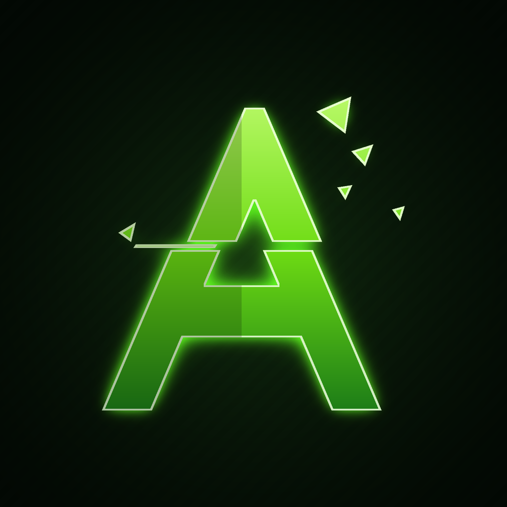

<p align="center">
  
</p>

<h1 align="center">Anomaly Xbox</h1>

<p align="center">
  Free, open-source Xbox Remote Play and xCloud streaming client for Android.
</p>

<p align="center">
  <a href="https://github.com/shahittoshariear-spec/anomaly-xbox/releases/latest">
    
  </a>
</p>

---

Anomaly Xbox is a personal fork of [XStreaming](https://github.com/Geocld/XStreaming)
v2.12.0, rebuilt as a standalone app for playing an Xbox console on a phone with any
standard Android gamepad.

## Features

- **Xbox Remote Play** — stream your own Xbox One or Xbox Series S|X over the local network
- **Xbox Cloud Gaming** — play Game Pass titles (Game Pass Ultimate required)
- Up to 1080p with hardware video decoding and rumble
- Works with standard Android HID gamepads, including the GameSir X5 Lite and Nova Lite
- Anomaly launcher icon, monochrome icon and dark splash screen
- Update checker disabled by default and pointed at this repository

## Download

Grab the latest signed APK from the
[**Releases**](https://github.com/shahittoshariear-spec/anomaly-xbox/releases/latest) page.

| | |
|---|---|
| Package | `app.anomaly.xbox` |
| Version | 2.12.0 |
| Minimum Android | 8.0 (API 26) |
| ABIs | arm64-v8a, armeabi-v7a |
| License | AGPL-3.0 |

## Setup

1. On the Xbox, open **Settings → Devices & connections → Remote features** and enable
   **Enable remote features**. Leave the console in standby with sleep mode enabled.
2. Install the APK and open the app.
3. Sign in with the Microsoft account that owns the console. Credentials go to Microsoft,
   not to this app.
4. Connect the phone and the console to the same network, then pick the console on the
   home screen.
5. For cloud gaming, sign in with an account that has Game Pass Ultimate and choose a title
   from the Cloud tab.

## Controllers

Any standard Android gamepad works over Bluetooth or USB. Pair it with the phone before
launching a stream; Android maps it as a HID gamepad and the app picks it up automatically.
The GameSir Nova Lite has been verified with this build.

## Build from source

Requirements: Node.js 20, JDK 17, Android SDK (platform 34, build-tools 35), Yarn.

```sh
yarn install
cd android
./gradlew :app:assembleProdRelease
```

The output APK is `android/app/build/outputs/apk/prod/release/app-prod-release.apk`. Before
installing, align it to 16 KB and sign it:

```sh
zipalign -P 16 -f 4 app-prod-release.apk app-prod-release-aligned.apk
apksigner sign --ks release.keystore --out app-prod-release-signed.apk app-prod-release-aligned.apk
```

The native libraries `libnano_rs.so`, `liblsfg-android.so` and `libSDL2.so` are checked in
under `android/app/src/main/jniLibs/`, so the Rust and CMake toolchains are not required to
build the app.

## Changes from upstream

See [MODIFICATIONS-XBOX.md](MODIFICATIONS-XBOX.md). In short: new app id and label, Anomaly
icons and splash screen, About-screen branding, update checker disabled by default,
prebuilt native libraries instead of a Rust/CMake build, and a fixed malformed upstream
patch file.

## Limitations

- Built and statically validated, but not yet tested against real Xbox hardware.
- Xbox remote play requires the console to be configured for remote features and signed in
  with the same Microsoft account.
- Microsoft can change its streaming endpoints at any time; upstream XStreaming releases
  are the source of compatibility fixes.
- Personal use only. Not affiliated with or endorsed by Microsoft.

## License

This project is licensed under the **AGPL-3.0**, the same license as the upstream
XStreaming project. It contains work by the XStreaming authors and is distributed with the
same attribution. See [LICENSE](LICENSE).

Xbox, Xbox Series X|S and Xbox Cloud Gaming are trademarks of Microsoft Corporation.
XStreaming is a trademark of its respective owners.
